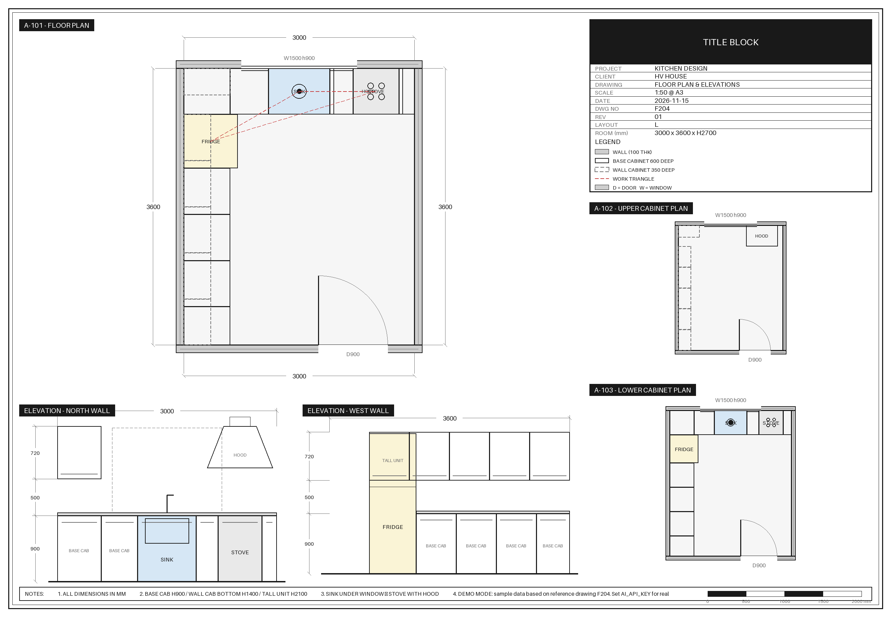

# Wood-cam — ربات تلگرام طراحی پلان آشپزخانه

ربات تلگرامی ابری (Serverless) که عکس اسکیس/نقشه‌ی آشپزخانه را دریافت می‌کند،
با هوش مصنوعی ابعاد را استخراج می‌کند و پس از تایید کاربر، یک **شیت فنی
حرفه‌ای چندنما** (مشابه نقشه‌های اجرایی F204) شامل پلان کف، نماهای روبه‌رو،
پلان کابینت‌های بالا و پایین و کادر عنوان ترسیم و ارسال می‌کند.



## جریان کار ربات

1. کاربر عکس اسکیس دستی آشپزخانه را در چت ربات می‌فرستد.
2. مدل بینا (Vision AI) تصویر را تحلیل و ابعاد دیوارها، موقعیت درها/پنجره‌ها
   و موانع (سینک، اجاق، یخچال، لوله و...) را به‌صورت JSON ساخت‌یافته استخراج می‌کند.
3. ربات ابعاد استخراج‌شده را به‌صورت متن فارسی برای کاربر نمایش می‌دهد.
4. پس از تایید کاربر (دکمه‌ی «✅ تایید و ترسیم»)، شیت فنی A3 ترسیم می‌شود:
   - **پلان کف (A-101):** دیوارها، درها، پنجره‌ها، جانمایی کابینت و مثلث کاری
   - **نماهای روبه‌رو (Elevation):** هر دیوار کابینت‌دار با کابینت زمینی/دیواری،
     سینک، اجاق، هود، یخچال و خطوط اندازه‌ی ارتفاعی
   - **پلان کابینت‌های بالا (A-102) و پایین (A-103)**
   - **کادر عنوان (Title Block):** پروژه، مقیاس، تاریخ، شماره نقشه و راهنما
5. امکان اصلاح ابعاد با عکس جدید یا متن (مثلاً `3200x3800`) وجود دارد.

## ساختار پروژه

```
Wood-cam/
├── api/
│   └── webhook.py        # نقطه‌ی ورود سرورلس (Vercel/Netlify) — وب‌هوک تلگرام
├── bot/
│   ├── config.py         # تنظیمات از متغیرهای محیطی
│   ├── telegram.py       # کلاینت Telegram Bot API
│   ├── ai_analyzer.py    # تحلیل تصویر با مدل بینا (+ حالت نمایشی)
│   ├── planner.py        # ترسیم پلان دوبعدی و جانمایی کابینت (Pillow)
│   ├── handlers.py       # ماشین وضعیت گفتگو
│   ├── store.py          # ذخیره‌سازی سشن (حافظه / قابل توسعه به Redis)
│   └── main.py           # اجرای محلی با Long Polling
├── assets/
│   ├── sample_F204.jpg   # نقشه‌ی مرجع F204
│   └── sample_plan.png   # خروجی نمونه‌ی موتور ترسیم
└── tests/                # تست‌های واحد و سرتاسری
```

## راه‌اندازی

### ۱) ساخت ربات در تلگرام

1. به [@BotFather](https://t.me/BotFather) پیام دهید و `/newbot` بزنید.
2. توکن ربات را کپی کنید.

### ۲) اجرای محلی (تست سریع)

```bash
pip install -r requirements.txt
cp .env.example .env   # توکن را وارد کنید
python -m bot.main
```

> بدون تنظیم `AI_API_KEY` ربات در **حالت نمایشی** کار می‌کند و داده‌ی نمونه
> (بر اساس نقشه‌ی مرجع F204) برمی‌گرداند — برای تست کل جریان کافی است.

### ۳) استقرار سرورلس (Vercel)

```bash
# ۱) پروژه را به Vercel ایمپورت کنید (یا با CLI دیپلوی کنید)
# ۲) متغیرهای محیطی را در تنظیمات Vercel اضافه کنید:
#    TELEGRAM_BOT_TOKEN=...
#    AI_API_KEY=...        (اختیاری)
#    WEBHOOK_SECRET=...    (اختیاری)
# ۳) وب‌هوک را فعال کنید:
curl "https://api.telegram.org/bot<TOKEN>/setWebhook?url=https://<your-domain>/api/webhook"
```

برای Netlify یا هر هاست HTTP دیگر، کافی است تابع `handler` در
`api/webhook.py` را به روت `/api/webhook` متصل کنید — منطق اصلی ربات
(`bot.handlers.Bot.handle_update`) کاملاً مستقل از فریم‌ورک است.

### ۴) کلید هوش مصنوعی (اختیاری)

هر API سازگار با OpenAI پشتیبانی می‌شود (OpenAI، Azure، یا هر سرویس سازگار):

```bash
AI_API_KEY=sk-...
AI_BASE_URL=https://api.openai.com/v1
AI_MODEL=gpt-4o-mini
```

## تست

```bash
python -m pytest tests/ -q
```

## نکات فنی

- **استانداردهای ارگونومی:** عمق کابینت زمینی ۶۰۰ و دیواری ۳۵۰ میلی‌متر،
  مدول استاندارد ۶۰۰، ارتفاع زمینی ۹۰۰ / شروع دیواری ۱۴۰۰ / یونیت بلند ۲۱۰۰،
  سینک زیر پنجره، حداقل فاصله‌ی ۳۰۰ میلی‌متری سینک تا اجاق، هود بالای اجاق،
  نمایش مثلث کاری (سینک–اجاق–یخچال) و خط مقیاس (Scale Bar).
- **چیدمان‌های پشتیبانی‌شده:** L، U، I (مستقیم)، موازی (Parallel).
- **سشن:** پیاده‌سازی پیش‌فرض در حافظه است؛ برای استقرار چندنمونه‌ای در
  پروداکشن، اینترفیس `SessionStore` را با Redis/Upstash KV پیاده‌سازی کنید.
- **نقشه‌ی مرجع:** `assets/sample_F204.jpg` — نقشه‌ی فنی کابینت آشپزخانه F204
  که مبنای داده‌ی نمایشی و تست‌هاست.
